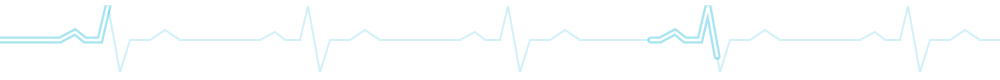

## 🧑‍💻 whoami

> **Software Developer & CISO @ YVB&Co** · 3rd-year B.E. CSE at Maharaja Institute of Technology Mysore · from Bannur, Mysuru 🇮🇳 · English · Kannada · Hindi

## 🛠️ Tech Stack

## 🚀 Shipped Products

| # | Product | Stack | |
|:-:|:--|:--|:-:|
| 01 | **No-Due Portal** — digitized No-Due clearance with PDF certificates | `React` `Node.js` `Tailwind` | [🌍 Live](https://noc-portal-self.vercel.app/) |
| 02 | **AcadOps ERP** — admissions, academics, attendance, exams | `Full Stack` `PostgreSQL` | 🔒 Private |
| 03 | **MITM PlacePro** — placement platform for students, admins, companies | `React` `Node.js` `Vercel` | [🌍 Live](https://mitm-placepro.vercel.app/) |
| 04 | **MRF** — research administration platform | `Full Stack` `Node.js` | [🌍 Live](https://mitm-rd.vercel.app/) |
| 05 | **SS Build** — materials booking & fleet logistics with live GPS | `React` `Node.js` | [🌍 Live](https://ss-builds.vercel.app) |
| 06 | **UdyogaMITra** — campus placement management | `Full Stack` `React` | [🌍 Live](https://mit-place-pro-five.vercel.app) |

<b>🎮 Also building & earlier projects</b>

- 🎮 [**GAME-MANIA**](https://github.com/bnyashavanth-prog/GAME-MANIA) — 3D parkour game in the browser (in development)
- 🏫 [**ERP.website**](https://github.com/bnyashavanth-prog/ERP.website) — early ERP: attendance & marks upload
- 📚 [**lms-website**](https://github.com/bnyashavanth-prog/lms-website) — Learning Management System
- 🏨 [**hotel**](https://github.com/bnyashavanth-prog/hotel) — hotel website

## 🗺️ Journey

## 📈 Activity

<picture>
  <source media="(prefers-color-scheme: dark)" srcset="https://raw.githubusercontent.com/bnyashavanth-prog/bnyashavanth-prog/output/github-snake-dark.svg" />
  <source media="(prefers-color-scheme: light)" srcset="https://raw.githubusercontent.com/bnyashavanth-prog/bnyashavanth-prog/output/github-snake.svg" />
  
</picture>

## 🏆 Hackathons

<b>HACKVERSE · Escape X · Ideathon (2025, Dept. of CSE, MITM)</b>

Inter-college hackathon, technical event and idea-pitching event. They taught me teamwork, fast problem-solving and explaining ideas clearly.

## 🤝 Let's Talk

<!-- Add your real LinkedIn URL, then uncomment:

-->

